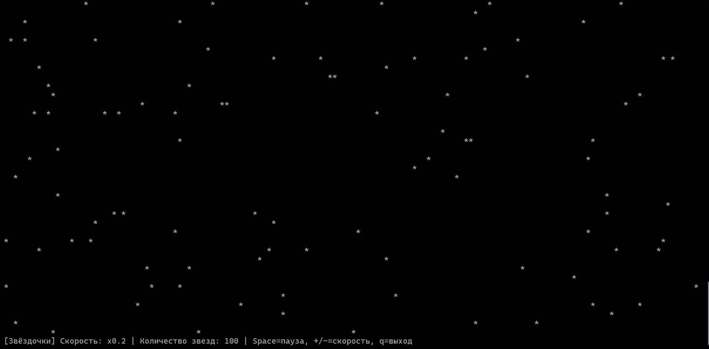

# Лабораторная работа 1: Консольная ASCII-графика

Программа реализует анимацию "Падающие звёзды" в консоли с использованием стандартных средств Python. 

## Демонстрация выполнения работы программы


## Описание задачи

Необходимо разработать программу, которая реализует анимацию падающих символов "*". Звезды движутся сверху вниз с разной скоростью. При достижении низа экрана звезда переносится наверх в случайную колонку. Требуется, чтобы все звёзды обновлялись синхронно.

## Программа реализована на языке:

| Язык | Интерпретатор/Версия | Среда разработки |
| :--- |:---------------------| :--- |
| Python | Python 3.12          | PyCharm Community Edition 2024.2.4|

## Используемые библиотеки:

Используемые базовые библиотеки:
* `sys` — для вывода в консоль и настройки кодировки.
* `os` — для получения размера терминала и управления консолью.
* `random` — для генерации случайных координат и скоростей звезд.
* `time` — для задания фиксированной частоты кадров.
* `msvcrt` — для неблокирующего чтения клавиш на Windows.

## Описание возможностей:

Программа позволяет наблюдать за падающими звёздами в консоли. Предусмотрено управление скоростью и паузой. Графика реализована через ANSI-escape последовательности (перемещение курсора, очистка экрана, скрытие курсора), что обеспечивает плавную анимацию без мерцания.

* `Space` — пауза/продолжить.
* `+` / `-` — увеличить/уменьшить скорость падения.
* `q` — выход из программы (с корректным восстановлением курсора и очисткой экрана).

## Установка и запуск:

1. Скачайте файл `main.py` из этого репозитория.
2. Откройте папку с файлом `main.py` в Проводнике Windows.
3. В адресной строке папки введите `cmd` и нажмите `Enter`.
4. Выполните следующую команду:

```bash
python main.py
```

## Использование программы:

* Запустите программу. Экран консоли очистится, и начнется анимация падающих звёзд.
* Нажмите `Пробел` (Space), чтобы поставить анимацию на паузу. Повторное нажатие возобновит работу.
* Используйте клавиши `+` (плюс) и `-` (минус), чтобы увеличить или уменьшить скорость падения звёзд.
* Для выхода из программы нажмите клавишу `q`. Консоль вернется в исходное состояние, курсор станет видимым.